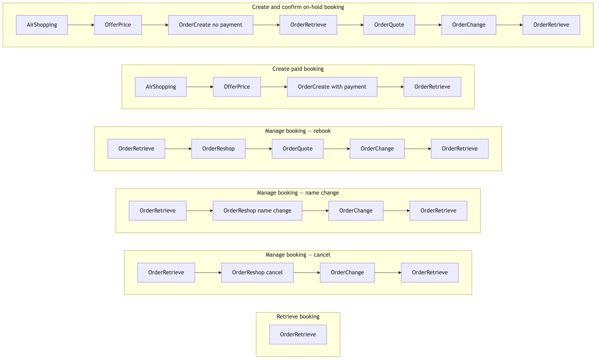
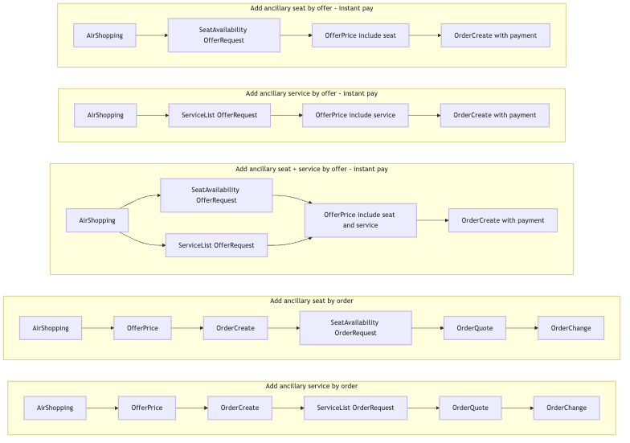

# NDC API Generic Integration Guide

## Table of Contents

- [NDC API Generic Integration Guide](#ndc-api-generic-integration-guide)
  - [Table of Contents](#table-of-contents)
  - [Change Log](#change-log)
- [Introduction](#introduction)
  - [Base URLs](#base-urls)
  - [HTTP headers and authentication](#http-headers)
- [Business Flow](#business-flow)
  - [Booking and servicing scenarios](#booking-and-servicing-scenarios)
  - [Ancillary seat and service scenarios](#ancillary-seat-and-service-scenarios)
- [NDC XML (Offers & Orders)](#ndc-xml-offers--orders)
- [Postman Collection](#postman-collection)
- [Code Lists](#code-lists)
  - [Passenger Type (PTC)](#passenger-type-ptc)
  - [Cabin Type](#cabin-type)
  - [Document Type](#document-type)
- [NDC for Offers & Orders workflow](#ndc-for-offers--orders-workflow)
  - [Basic request format (API key)](#basic-request-format-api-key)
  - [Partner identification (DistributionChain)](#partner-identification-distributionchain)
  - [Message attributes (PayloadAttributes)](#payload-attributes)

## Change Log

| Change Description                                                                                              | Changed By              | Change Date |
|-----------------------------------------------------------------------------------------------------------------|-------------------------|-------------|
| `PayloadAttributes` with a per-message `CorrelationID` is required on every NDC message: fields echoed, element order, `CorrelationID` returned as `Error/ErrorID` (GH-8220) | Naphachara Rattanawilai | 2026-10-19 |
| Deeplink: URL pattern example; offers without an agreement use the partner's agreement with the airline (GH-8052) | Naphachara Rattanawilai | 2026-10-16  |
| AirShopping: document the offer booking deeplink, agreement template override and template variables (GH-8427)  | Naphachara Rattanawilai | 2026-10-15  |
| DistributionChain must identify the calling partner on every NDC message (GH-8269)                              | Naphachara Rattanawilai | 2026-10-14  |
| NDC requests send only the x-api-key header; x-tenant and x-SalesChannel removed from docs and the Postman collection (GH-8269) | Naphachara Rattanawilai | 2026-10-15  |
| Added `AirlineProfile` (IATA NDC 21.3): airport pairs each airline serves, by airline (`OwnerCode`)             | Andrii Denysenko        | 2026-10-06  |
| Added Postman folder `UseCase - VI` and the `NDC-VI` environment for Virtual Interline (GH-8184)              | Apiluck Dokkaew         | 2026-10-06  |
| Name change: one OrderChange with payment (no separate payment OrderChange) (GH-8162)                            | Naphachara Rattanawilai | 2026-09-24  |
| Cancel booking flow has no OrderQuote; removed OrderQuote cancel section (GH-8162)                             | Naphachara Rattanawilai | 2026-09-24  |
| Removed phase wording from scenario sections; OrderQuote required where used; name change has no OrderQuote (GH-8162) | Naphachara Rattanawilai | 2026-09-22  |
| AirShopping: document `CabinTypeCode` filter and required `PrefLevel` (ET-58650)                                | Naphachara Rattanawilai | 2026-08-19  |
| Production base URL updated to `https://go7-api-gateway.prod.go7.io/ndc-gateway` (GH-7540)                      | Naphachara Rattanawilai | 2026-08-04  |
| OrderChange: call OrderRetrieve and reuse PaxIDs before the next process (GH-7531 / GH-7171)                    | Naphachara Rattanawilai | 2026-08-04  |
| SeatAvailability: document multiple `OfferItemRefID` per seat — partner guidance (GH-7532 / GH-7253)            | Naphachara Rattanawilai | 2026-08-04  |
| OrderCreate supports combined OfferPrice `OfferID` (composite flight + service + seat)                | Naphachara Rattanawilai | 2026-08-03  |
| Added OrderChange payment with credit card and debit/credit account (`OT` + RemarkText account ID)              | Naphachara Rattanawilai | 2026-07-27  |
| Phase 2 by-offer: OfferPrice only after SeatAvailability/ServiceList; instant-pay note; mixed seat+service flow | Jarun Jiamtaweeboon     | 2026-07-23  |
| Updated OfferPrice for Phase 2 combined flight + service / seat pricing                                         | Jarun Jiamtaweeboon     | 2026-07-22  |
| Updated Phase 2 add-ancillary flows, workflow images, credit-card PCI payment                                   | Naphachara Rattanawilai | 2026-07-20  |
| Updated Postman collection with Phase 2 endpoints                                                               | Tyler Thorin            | 2026-05-19  |
| Added Phase 2 to the document                                                                                   | Tyler Thorin            | 2026-05-12  |
| Prepared Postman collection and update API request/response example                                             | Thotsaphorn Phonlabutr  | 2026-05-08  |
| Initial creation of the document                                                                                | Naphachara Rattanawilai | 2026-05-06  |

# Introduction

This document outlines generic integration with the Go7 **NDC Gateway** using **IATA NDC Offers & Orders** XML messages. Schema distribution **21.3** is exposed under the HTTP path **`/v21.3.5`**. Per-message field references also live under [`ndc/endpoints/`](endpoints/airshopping.md).

Requests use **XML bodies** with **`Content-Type: application/xml`** (or `application/xml;charset=UTF-8`). **[HTTP headers and authentication](#http-headers)** describes tenant/channel headers and API key usage.

## Base URLs

Use these hosts with the paths documented per endpoint (for example `POST …/v21.3.5/AirShopping`).

| Environment               | Base URL |
|---------------------------|-----------|
| Production (platform API) | `https://go7-api-gateway.prod.go7.io/ndc-gateway` |
| Test (platform API)       | `https://go7-api-gateway.dev.go7.io/ndc-gateway` |

All Offers & Orders messages documented here are posted under:

`https://go7-api-gateway.prod.go7.io/ndc-gateway/v21.3.5/<MessageName>`

## HTTP Headers

Attach the following headers to NDC Gateway requests unless an endpoint page specifies otherwise.

| Header | Description | Example |
|--------|-------------|---------|
| `x-api-key` | API key authentication (required) | `{x-api-key}` |
| `Content-Type` | Request body type | `application/xml` |

Send only `x-api-key` and `Content-Type`. The API key alone identifies the caller; the gateway resolves the airline, account and sales channel from it.

# Business Flow

These scenarios cover shopping and pricing offers, creating or confirming orders, reshop/requote paths, order retrieval, and adding ancillary seats and services using either offer context (price into `OrderCreate`) or order context (`OrderQuote` then `OrderChange`).

## Booking and servicing scenarios

| Scenario                         | Message sequence                                                                                                                            |
|----------------------------------|---------------------------------------------------------------------------------------------------------------------------------------------|
| Create & confirm on-hold booking | `AirShopping` → `OfferPrice` → `OrderCreate`(no payment) → `OrderRetrieve` → `OrderQuote` → `OrderChange` → `OrderRetrieve`.                |
| Create paid booking              | `AirShopping` → `OfferPrice` → `OrderCreate` (with payment) →`OrderRetrieve`.                                                               |
| Create zero-amount booking       | `AirShopping` → `OfferPrice` → `OrderCreate` (no `PaymentFunctions`) → `OrderRetrieve`. Total due is 0, so the gateway [autopays](#zero-amount-autopayment) it and the order returns `OPEN`. |
| Manage booking — rebook          | `OrderRetrieve` → `OrderReshop` → `OrderQuote` → `OrderChange` → `OrderRetrieve`.                                                           |
| Manage booking — name change     | `OrderRetrieve` → `OrderReshop` (name change) → `OrderChange` (with payment) → `OrderRetrieve`. **No `OrderQuote`** — one `OrderChange` accepts the reshop offer and pays for it. |
| Manage booking — cancel          | `OrderRetrieve` → `OrderReshop` (cancel) → `OrderChange` → `OrderRetrieve`. **No `OrderQuote`** — `OrderChange` accepts the cancel offer directly. |
| Retrieve booking                 | `OrderRetrieve` (view only).              |

### NDC Gateway workflow — booking and servicing

Scenario flow (**NDC Gateway — NDC Workflow Process, booking and servicing**). Source Mermaid: [scenario flow diagram source](mermaid/ndc-phase1-scenario-flow.mmd).



IATA **`OrderRetrieveRQ`** is mapped to internal order REST reads (UUID vs record locator + traveler name): see [Order Retrieve mapping](endpoints/orderretrieve.md).

**Partner note — refresh `PaxID` after `OrderChange`:** `PaxID` values may change between responses after an `OrderChange` (for example after adding SSRs or confirming payment). If the integration continues with another step (payment, add seat/SSR, reshop, another change), call **`OrderRetrieve`** first, read the current `PaxList/Pax/PaxID` (and related refs) from the retrieve response, and use those IDs in the next request. Do **not** reuse `PaxID` values from an earlier `OrderCreateRS` or previous `OrderChangeRS` across steps.

## Ancillary seat and service scenarios

These build on the same base flow as the [booking and servicing scenarios](#booking-and-servicing-scenarios), adding seat and service selection.

| Scenario                               | Message sequence                                                                                                                      |
|----------------------------------------|---------------------------------------------------------------------------------------------------------------------------------------|
| Add ancillary seat by offer            | `AirShopping` → `SeatAvailability` (`OfferRequest`) → `OfferPrice` (flight + seat) → `OrderCreate` (with payment).                   |
| Add ancillary service by offer         | `AirShopping` → `ServiceList` (`OfferRequest`) → `OfferPrice` (flight + service) → `OrderCreate` (with payment).                      |
| Add ancillary seat + service by offer  | `AirShopping` → `SeatAvailability` + `ServiceList` (`OfferRequest`) → `OfferPrice` (flight + seat + service) → `OrderCreate` (with payment). |
| Add ancillary seat by order            | `AirShopping` → `OfferPrice` → `OrderCreate` → `SeatAvailability` (`OrderRequest`) → `OrderQuote` → `OrderChange` → `OrderRetrieve`. |
| Add ancillary service by order         | `AirShopping` → `OfferPrice` → `OrderCreate` → `ServiceList` (`OrderRequest`) → `OrderQuote` → `OrderChange` → `OrderRetrieve`.      |

**Remark:** By-offer ancillary flows are **instant pay** (`OrderCreate` with `PaymentFunctions`). For **pay-later / on-hold**, use the [booking and servicing scenarios](#booking-and-servicing-scenarios) (`AirShopping` → `OfferPrice` → `OrderCreate` without payment), then add ancillaries via the **by-order** rows above.

### Zero-amount seats and services (Autopayment)
{: #zero-amount-autopayment}

When you add a **seat or SSR whose amount due is 0** to an existing order (by order), the gateway pays it automatically with **Autopayment**. Nothing is charged.

`OrderRetrieve` → `SeatAvailability` / `ServiceList` (`OrderRequest`, item priced 0) → `OrderQuote` (amount due 0) → `OrderChange` **without `PaymentFunctions`** → `OrderRetrieve`.

- `OrderChange` accepts the quoted offer, autopays the 0 amount and confirms the seat or SSR. The response has no pending payment.
- If `PaymentFunctions` is sent anyway, it is ignored for a zero amount (no card or account is charged).
- Still call `OrderQuote` and `OrderChange`; only the payment step is dropped.
- The same applies to a zero-total `OrderCreate` (returned `OPEN`, not held `DRAFT`) and to paying an on-hold order whose balance is 0.
- Zero means the final amount due, including taxes, fees and penalties. If anything is still payable, send `PaymentFunctions` as usual.

More detail: [NDC Partner Guide → Zero-amount orders (Autopayment)](NDC_PARTNER_GUIDE.md#zero-amount-autopayment).

**Remark — multi-step OrderChange:** when chaining changes on an existing order (for example add SSR then pay), insert **`OrderRetrieve`** between steps and use the latest `PaxID` values: `… → OrderChange (add SSR) → OrderRetrieve → OrderChange (payment)`.

**Remark — SeatAvailability offer items:** a seat in `SeatAvailabilityRS` may return **multiple** `OfferItemRefID` values (for example different passenger eligibility). See [Seat Availability](endpoints/seatavailability.md).

### NDC Gateway workflow — adding seats and services

Scenario flow (**NDC Gateway — NDC Workflow Process, ancillaries**).



# NDC XML (Offers & Orders)

Use IATA **OffersAndOrders** message XML (`IATA_AirShoppingRQ`, `IATA_OrderCreateRQ`, etc.) as shown in each endpoint document. Official XSDs are published by IATA for distribution **21.3**; align payloads with the examples in [`ndc/endpoints/`](endpoints/airshopping.md).

**Airline Profile schemas.** The package below does not contain the [`AirlineProfile`](endpoints/airlineprofile.md) message schemas. Download [IATA_AirlineProfileRQ.xsd](/docs/assets/resources/IATA_AirlineProfileRQ.xsd) and [IATA_AirlineProfileRS.xsd](/docs/assets/resources/IATA_AirlineProfileRS.xsd); they import `IATA_OffersAndOrdersCommonTypes.xsd` from the package.

# NDC XML package
[Download the IATA schema distribution 21.3 package used by GO7 gateway v21.3.5](/docs/assets/resources/NDC-xmlbeans-21.3.5.zip)

# Postman Collection
[Download Postman Collection](/docs/assets/resources/NDC_postman_collection.json)
[Download Postman Environment](/docs/assets/resources/NDC.postman_environment.json)
[Download Postman Environment for Virtual Interline (NDC-VI)](/docs/assets/resources/NDC-VI.postman_environment.json)

Please update the variables in collection such as x-api-key, ndc-gateway-url.

## UseCase - VI (Virtual Interline)

The collection carries a second top-level folder, `UseCase - VI`, for a **Virtual Interline** sale: one itinerary stitched from two carriers on two reservation systems, sold and paid as one NDC order. Use it with the `NDC-VI` environment and your VI API key (the key selects the tenant and the sales channel). It covers *Create & confirm on-hold booking*, *Create paid booking*, *Retrieve booking* and the ancillary flows (*Ancillary Offer - Services / Seats* before booking, *Ancillary Order - Services / Seats* on an existing order). A VI offer has one offer item per passenger per leg (OW 6, RT 12); the folder's scripts select every item and read all ids from the previous response, so nothing is hard-coded and a request whose inputs are missing is not sent. Cancel, cancel segment, rebook and name change are not included because they are not supported on VI; the folder description lists the known limits per use case.

# Code Lists

## Passenger Type (PTC)

| Code | Description |
|------|-------------|
| ADT | Adult |
| CHD | Child |
| INF | Infant |

## Cabin Type

Hub cabin codes (not numeric PADIS values such as `5`). Used on **[AirShopping](endpoints/airshopping.md)** as `OriginDestCriteria.CabinType.CabinTypeCode` and returned on `FareComponent.CabinType.CabinTypeCode`.

| Code | Description |
|------|-------------|
| Y | Economy |
| C | Business |
| F | First |
| W | Premium economy |
| M | Miscellaneous (accepted, not used in practice) |

When `CabinType` is present on AirShopping, IATA NDC 21.3 requires `PrefLevel/PrefLevelCode` (`minOccurs=1`). Missing either field returns IATA error 13. Use `Required` to keep only matching cabin offers per origin-destination. `Preferred` is sent to offer search but does not drop other cabins. Invalid cabin codes return IATA error 14.

## Document Type

| Code | Description |
|------|-------------|
| PP   | Passport |
| ID   | National ID |
| DL   | Driver’s License |
| FP   | Frequent Flyer |

## Error Code

| Code | Type        | Description                          |
|------|-------------|--------------------------------------|
| 12   | VALIDATION  | Invalid value                        |
| 13   | VALIDATION  | Missing required field               |
| 14   | VALIDATION  | Value not supported in this position |
| 39   | VALIDATION  | Data element too long                |
| 40   | VALIDATION  | Data element too short               |
| 903  | VALIDATION  | Unable to process - syntax error     |
| 914  | VALIDATION  | Invalid format                       |
| 915  | VALIDATION  | No action - cannot support function  |
| 911  | BUSINESS    | Unable to process - system error     |
| 913  | APPLICATION | Item/data not found                  |
| 486  | APPLICATION | Specific seat requested not available |
| 304  | SYSTEM      | System Temporarily Unavailable       |
| 900  | SYSTEM      | Inactivity Time Out Value Exceeded   |
| 901  | SYSTEM      | Communications Line Unavailable      |
| 916  | SYSTEM      | EDIFACT/XML version not supported    |
| 305  | SECURITY    | Security/Audit Failure               |

Codes 12 and 13 on `Request.DistributionChain` (partner keys) are explained in [Partner identification (DistributionChain)](#partner-identification-distributionchain).

# NDC for Offers & Orders workflow

Same pattern as **[OTA for Reservation workflow](../ota/OTA_API.md#ota-for-reservation-workflow)**: this section is an **index only**. Each **step** links to the endpoint reference page where requests, responses, and scenario anchors live. See **[HTTP headers and authentication](#http-headers)**.

Optionally start with **AirlineProfile** to list the airport pairs an airline serves. Typical chain: **AirShopping → OfferPrice → OrderCreate**, then **OrderRetrieve** / **OrderReshop** / **OrderQuote** / **OrderChange** as needed (see [Booking and servicing scenarios](#booking-and-servicing-scenarios)). Ancillaries by offer: **AirShopping → SeatAvailability and/or ServiceList → OfferPrice** (flight + selected extras) → **OrderCreate** (instant pay). Ancillaries by order: create the order first, then **SeatAvailability** / **ServiceList** (`OrderRequest`) → **OrderQuote** → **OrderChange** → **OrderRetrieve** (see [Ancillary seat and service scenarios](#ancillary-seat-and-service-scenarios)). After any **OrderChange**, call **OrderRetrieve** before the next process and use the latest **PaxID** values.

| | Production-style base | Message path pattern |
|--|------------------------|----------------------|
| Offers & Orders API | `https://go7-api-gateway.prod.go7.io/ndc-gateway` | `/v21.3.5/<MessageName>` |

- **0 — [Airline Profile](endpoints/airlineprofile.md)** (optional) — `POST …/AirlineProfile` · airport pairs each airline serves, before **AirShopping**
  - [All profiles](endpoints/airlineprofile.md#airlineprofile-all)
  - [By airline](endpoints/airlineprofile.md#airlineprofile-by-owner)
  - [Several airlines](endpoints/airlineprofile.md#airlineprofile-several-owners)
- **1 — [Air Shopping](endpoints/airshopping.md)** — `POST …/AirShopping` · `IATA_AirShoppingRQ` / `RS`
  - [One-way trip](endpoints/airshopping.md#airshopping-one-way-trip)
  - [Round trip](endpoints/airshopping.md#airshopping-round-trip)
- **2 — [Offer Price](endpoints/offerprice.md)** — `POST …/OfferPrice` · priced offer for **OrderCreate** (flight-only, or combined with selected service / seat)
  - [One-way](endpoints/offerprice.md#offerprice-one-way-trip)
  - [Round trip](endpoints/offerprice.md#offerprice-round-trip)
  - [With selected service](endpoints/offerprice.md#offerprice-with-service)
  - [With selected seat](endpoints/offerprice.md#offerprice-with-seat)
  - [With selected service and seat](endpoints/offerprice.md#offerprice-with-service-and-seat)
- **3 — [Order Create](endpoints/ordercreate.md)** — `POST …/OrderCreate` · accept priced offer; optional payment; echo composite OfferPrice `OfferID` when flight was priced with seat/SSR
  - [Pay later (on hold)](endpoints/ordercreate.md#ordercreate-pay-later)
  - [Instant pay](endpoints/ordercreate.md#ordercreate-instant-pay)
  - [Combined offer (flight + seat and/or SSR)](endpoints/ordercreate.md#ordercreate-combined-offer)
- **4 — [Seat Availability](endpoints/seatavailability.md)** — `POST …/SeatAvailability` · optional seat map and seat offer lookup; a seat may return **multiple** `OfferItemRefID` values
  - [By offer](endpoints/seatavailability.md#seatavailability-by-offer)
  - [By order](endpoints/seatavailability.md#seatavailability-by-order)
- **5 — [Service List](endpoints/servicelist.md)** — `POST …/ServiceList` · optional ancillary service lookup
  - [By offer](endpoints/servicelist.md#servicelist-by-offer)
  - [By order](endpoints/servicelist.md#servicelist-by-order)
- **6 — [Order Retrieve](endpoints/orderretrieve.md)** — `POST …/OrderRetrieve` · current order view; **required before the next process** after `OrderChange` to refresh `PaxID`
  - [By Order ID](endpoints/orderretrieve.md#orderretrieve-by-order-id)
  - [By Booking Reference](endpoints/orderretrieve.md#orderretrieve-by-booking-reference)
- **7 — [Order Reshop](endpoints/orderreshop.md)** — `POST …/OrderReshop` · alternatives for rebook, name change, or cancel
  - [Rebook](endpoints/orderreshop.md#orderreshop-rebook)
  - [Name change offer](endpoints/orderreshop.md#orderreshop-name-change)
  - [Cancel order](endpoints/orderreshop.md#orderreshop-cancel-order)
- **8 — [Order Quote](endpoints/orderquote.md)** — `POST …/OrderQuote` · quote before **OrderChange**
  - [Rebook quote](endpoints/orderquote.md#orderquote-rebook)
  - [Booking (confirm on-hold quote)](endpoints/orderquote.md#orderquote-booking)
- **9 — [Order Change](endpoints/orderchange.md)** — `POST …/OrderChange` · pay **DRAFT**, or accept quoted / rebook offers; after success, call **OrderRetrieve** before the next step
  - [Payment on hold booking](endpoints/orderchange.md#orderchange-payment-on-hold)
  - [Payment with debit](endpoints/orderchange.md#orderchange-payment-debit)
  - [Payment with credit](endpoints/orderchange.md#orderchange-payment-credit)
  - [Payment with debit/credit account](endpoints/orderchange.md#orderchange-payment-debit-credit-account)
  - [Payment with credit card (PCI Proxy)](endpoints/orderchange.md#orderchange-payment-credit-card) — **requires 3DS Authenticate Result** (`SecurePaymentVersion2`)
  - [Rebook with new offers](endpoints/orderchange.md#orderchange-rebook)

## Basic request format (API key)

```bash
curl -X POST "https://go7-api-gateway.prod.go7.io/ndc-gateway/v21.3.5/<MessageName>" \
  -H "x-api-key: {x-api-key}" \
  -H "Content-Type: application/xml" \
  --data-binary @request.xml
```

Replace `<MessageName>` with `AirlineProfile`, `AirShopping`, `OfferPrice`, `OrderCreate`, etc.

## Partner identification (DistributionChain)
{: #partner-identification-distributionchain}

If your API key identifies a **partner**, every NDC message must name you in `DistributionChain`: `AirlineProfile`, `AirShopping`, `OfferPrice`, `OrderCreate`, `OrderRetrieve`, `OrderChange`, `OrderReshop`, `OrderQuote`, `ServiceList` and `SeatAvailability`. API keys that do not identify a partner are not affected.

**Rules**

- Put your **Partner ID** (UUID) in a `DistributionChainLink` as `ParticipatingOrg/OrgID`. It is compared ignoring upper/lower case and surrounding spaces.
- That link's `OrgRole` must match your agreement:

| Your agreement | `OrgRole` on your link |
|----------------|------------------------|
| Sales | `Seller` |
| Network | `Distributor` |
| Sales and Network | `Seller` or `Distributor` |
| Marketplace / Tour Operator only | Any (only the Active-agreement check applies) |

- You need at least one **Active** agreement with an airline you may sell.
- Links with `OrgRole` `Carrier` never count as your link. `Name` is not checked.
- Your agreements always come from your API key. Nothing in the request changes which agreements or offers are used.

```xml
<DistributionChain>
    <cns:DistributionChainLink>
        <cns:Ordinal>1</cns:Ordinal>
        <cns:OrgRole>Seller</cns:OrgRole>
        <cns:ParticipatingOrg>
            <cns:Name>Your company</cns:Name>
            <cns:OrgID>7f9c2b1e-3a4d-4e5f-8a6b-1c2d3e4f5a6b</cns:OrgID>
        </cns:ParticipatingOrg>
    </cns:DistributionChainLink>
</DistributionChain>
```

**Errors** — checked in this order; each returns **HTTP 400** with an `Error` in that message's response (for example `IATA_AirShoppingRS`).

| Case | Code | DescText | TagText |
|------|------|----------|---------|
| `DistributionChain` missing | 13 | `Missing required field: Request.DistributionChain` | `Request.DistributionChain` |
| No `DistributionChainLink` | 13 | `Missing required field: Request.DistributionChain.DistributionChainLink` | `Request.DistributionChain.DistributionChainLink` |
| No Active agreement with any airline you may sell | 12 | `Partner has no active agreement` | `Request.DistributionChain` |
| Your Partner ID is not in a non-`Carrier` link | 12 | `DistributionChain does not contain the authenticated partner` | `Request.DistributionChain` |
| Your link has the wrong `OrgRole` | 12 | `OrgRole must be Seller for the authenticated partner` (or `Distributor`, or `Seller or Distributor`, per your agreement) | `Request.DistributionChain.DistributionChainLink[i].OrgRole` |

If your agreements cannot be checked at that moment, the API returns that HTTP status with Code **911** (system error). The request is not processed; retry later.

## Message attributes (PayloadAttributes)
{: #payload-attributes}

**Send `PayloadAttributes` on every NDC message, with a `CorrelationID` in it.** Both are required for integration with the GO7 NDC Gateway.

The IATA schema itself declares `PayloadAttributes` `minOccurs="0"`, and the gateway does **not** currently reject a request that leaves it out — such a request is processed normally. That is not a reason to omit it: without a `CorrelationID` there is nothing that ties a response, or a line in the gateway's logs, back to the request you sent, and a problem report that cannot be traced to a call cannot be investigated.

**What the gateway does with it**

- Whatever you send is **echoed unchanged** in the response, before any processing of the business payload.
- `CorrelationID` is also written to the gateway's own logs, and on a failure it comes back as `Error/ErrorID` in the error response. Quote it when you report a problem.
- Error responses carry the `Error` element only — no `PayloadAttributes` is echoed on a failed request.
- If you omit `PayloadAttributes`, the response has no `PayloadAttributes` either, and the gateway logs the message without your correlation ID.

**Fields**

| Element | Required | Use |
|---------|----------|-----|
| `CorrelationID` | **Yes** | Your ID for this single message. Use a **fresh UUID per request** — never reuse one across messages. Echoed in the response, written to the gateway logs, and returned as `Error/ErrorID` when the request fails. |
| `Timestamp` | Recommended | Creation date and time of the message, `xs:dateTime` (for example `2026-05-07T18:11:33.876+07:00`). Echoed. |
| `TrxID` | Recommended | Your ID for the whole transaction — keep it the same across `AirShopping` → `OfferPrice` → `OrderCreate` to group one booking flow. Echoed. |
| `VersionNumber` | Recommended | Schema distribution version: `21.3`. Echoed. |
| `PrimaryLangID` | Optional | Language preference (ISO 639). `AirShopping` uses it as `{LANG}` in the [booking deeplink](endpoints/airshopping.md#booking-deeplink); without it the language of the airline's country is used. Echoed. |

"Required" and "Recommended" above are GO7 integration requirements, not schema rules — every child is `minOccurs="0"` in the IATA schema, so nothing here is enforced by XSD validation.

The schema also allows `AltLangID`, `RetransmissionInd` and `SeqNumber`. The gateway accepts them but does **not** echo them; only the five fields above come back.

**Element order matters.** `PayloadAttributes` is an `xs:sequence`, so keep its children in schema order: `AltLangID`, `CorrelationID`, `PrimaryLangID`, `RetransmissionInd`, `SeqNumber`, `Timestamp`, `TrxID`, `VersionNumber` — note that `PrimaryLangID` goes *before* `Timestamp`. Children sent out of order are not reliably read: depending on the gateway's XSD-validation setting they are either rejected as a schema error or ignored, and an ignored field is not echoed back.

```xml
<PayloadAttributes>
    <cns:CorrelationID>32f9ddf2-bda9-4ca4-83ee-82a873c509f6</cns:CorrelationID>
    <cns:PrimaryLangID>en</cns:PrimaryLangID>
    <cns:Timestamp>2026-05-07T18:11:33.876+07:00</cns:Timestamp>
    <cns:TrxID>TRX-123456789</cns:TrxID>
    <cns:VersionNumber>21.3</cns:VersionNumber>
</PayloadAttributes>
```
